# EventDesk

A tracker for incoming event requests. Organizations send in invitations, donation requests, sponsorships and medical missions. EventDesk keeps all of them in one place, from the first request to the final decision, and reminds your team before each event happens.

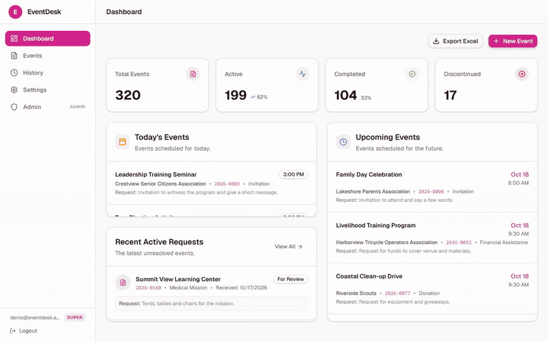

> The screenshots and GIF use fictional demo data. See [Try the demo](#try-the-demo).

## Features

- **Dashboard.** Total, active, completed and discontinued counts, today's events, upcoming events and the latest unresolved requests.
- **Fast event list.** Server-side search, filters, sorting and pagination, so it stays quick with thousands of records.
- **Active and history views.** Anything marked Done or Discontinued moves out of the working list and into History.
- **Detail panel.** Open any record without leaving the list, then edit it, delete it or send it to Telegram.
- **Admin-configurable fields.** Superadmins change labels, input types, dropdown options, required flags, defaults and badge colors from the UI. No code change or redeploy is needed.
- **File attachments.** Files upload straight from the browser to Cloudflare R2 through presigned URLs.
- **Telegram sharing.** Send an event, with its attachments, to a group chat in one click.
- **Automated email reminders.** A scheduled job emails opted-in users about upcoming events. See [Automated reminders](#automated-reminders).
- **Excel export** of the full dataset, which a superadmin can switch on or off.
- **Roles.** Regular users and superadmins, enforced with Supabase row-level security.
- **Daily database backups** to R2 through a GitHub Action.

## Screenshots

| | |
|---|---|
| 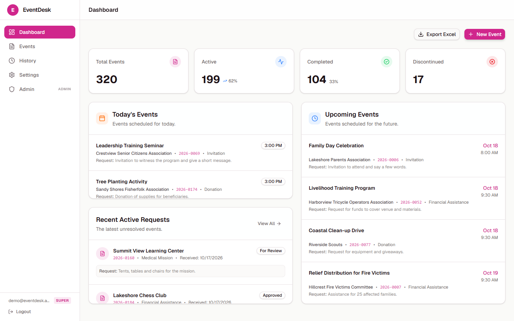 | 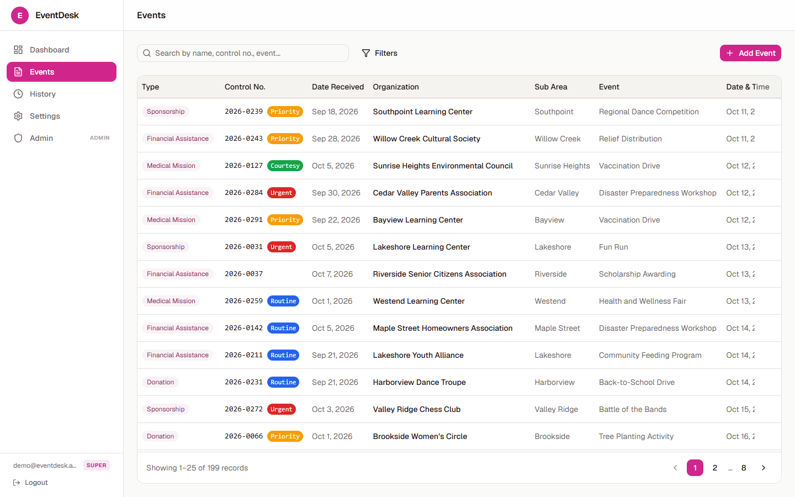 |
| **Dashboard** | **Events** with search, filters and pagination |
| 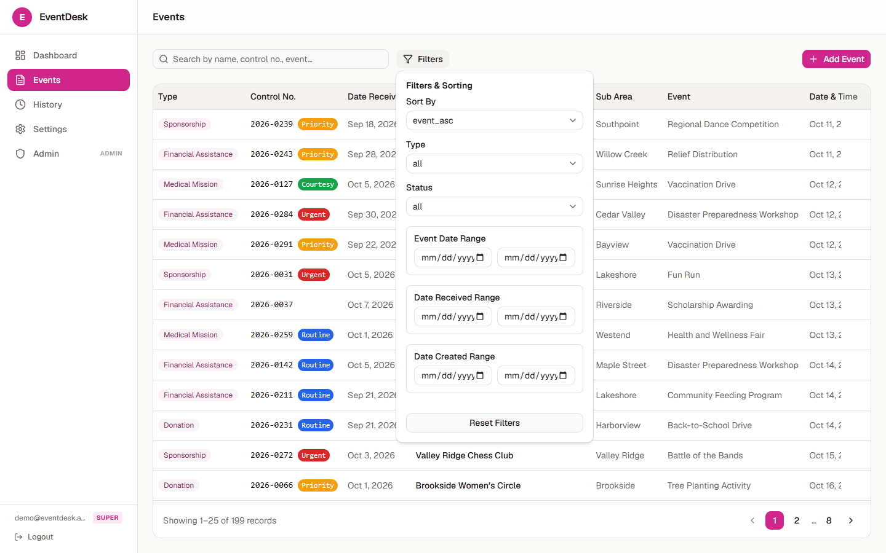 | 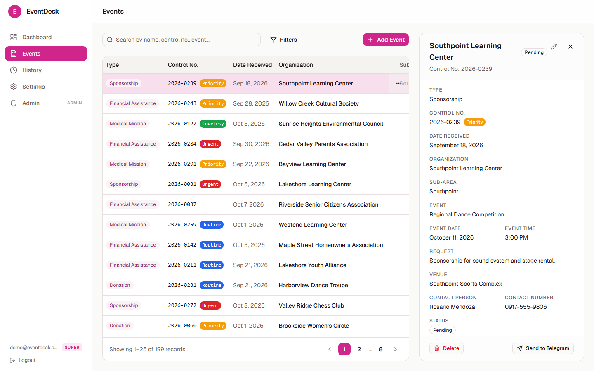 |
| **Filters and sorting** | **Detail panel** with Telegram sharing |
| 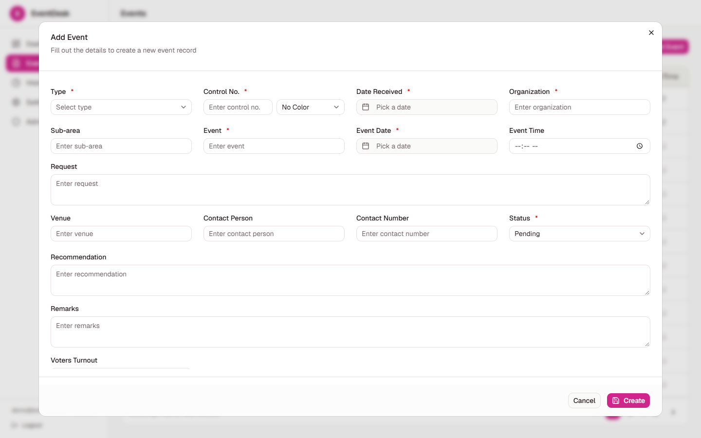 | 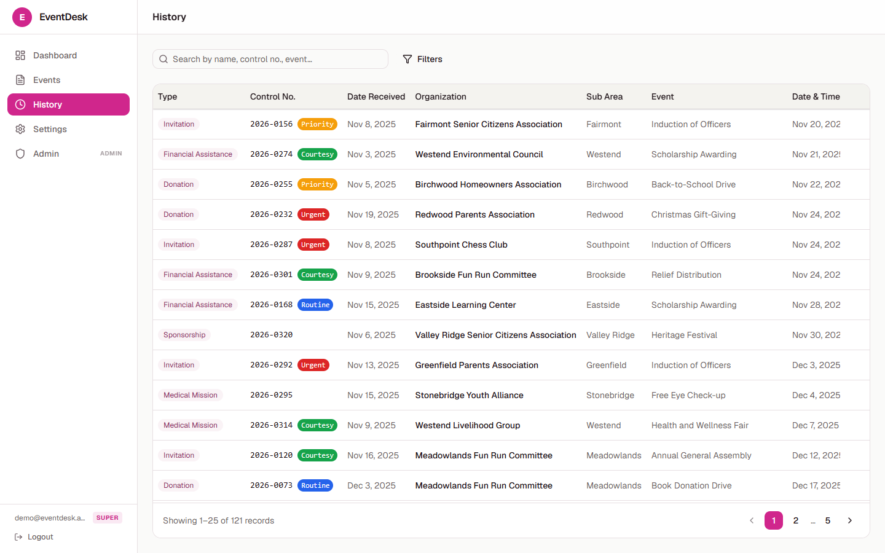 |
| **Add an event** | **History** of completed and discontinued requests |
| 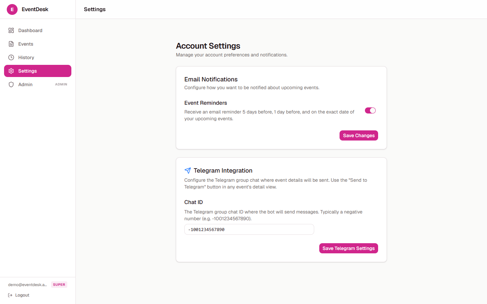 | 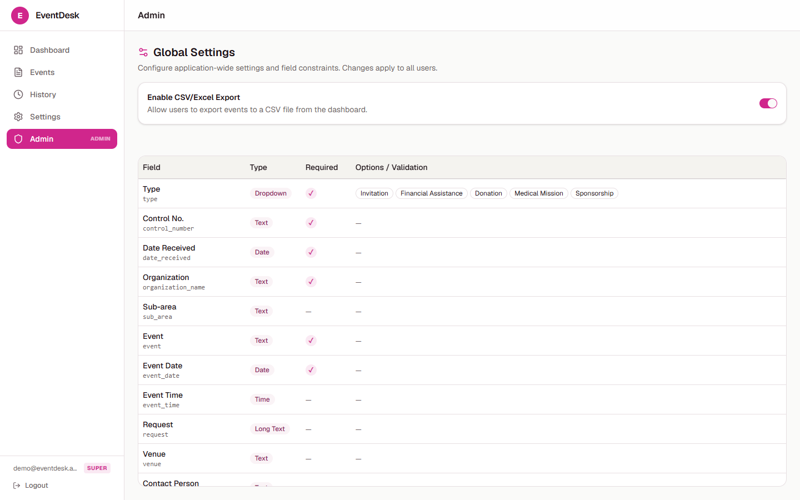 |
| **Settings** for reminders and Telegram | **Admin** field configuration |
| 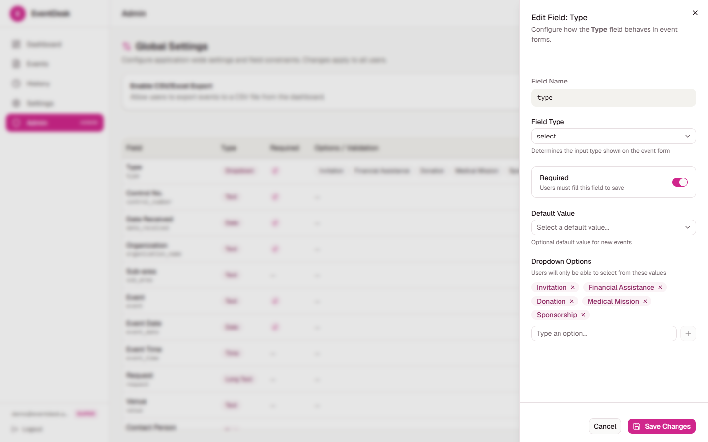 | 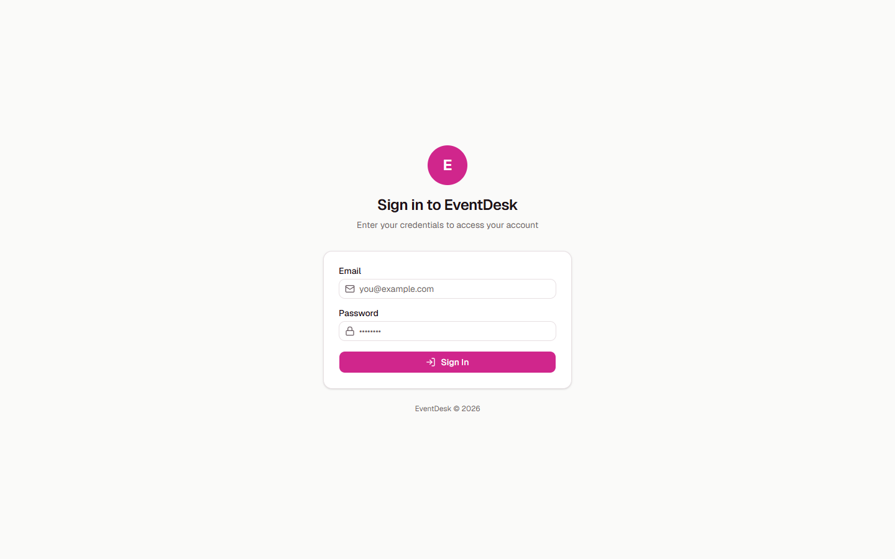 |
| **Editing a field** (type, options, colors) | **Sign in** |

## Tech stack

| Layer | Technology |
|---|---|
| Frontend | React 19, TypeScript, Vite, React Router |
| UI | Tailwind CSS v4, shadcn/ui on Base UI, Lucide icons, Sonner toasts |
| Backend | Supabase (Auth, Postgres with row-level security, Edge Functions on Deno) |
| Files | Cloudflare R2 (presigned uploads) |
| Hosting | Cloudflare Workers |
| Notifications | Telegram Bot API, Gmail SMTP (Nodemailer), Supabase `pg_cron` |
| Export | ExcelJS |

## Architecture

```
Browser (React SPA)
   │
   ├── Supabase JS client (anon key + RLS) ──► Postgres: solicitations, field_configs,
   │                                            profiles, user_settings, app_settings
   │
   ├── Edge function: generate-r2-upload-url ──► Cloudflare R2 (attachments/)
   ├── Edge function: send-telegram ───────────► Telegram group chat
   │
pg_cron (scheduled) ──► Edge function: send-reminders ──► Gmail SMTP ──► users' inboxes
```

There's no server of its own. The browser talks to Supabase directly, and access control lives in row-level security policies. Edge functions handle the things that need secrets: signing R2 uploads, calling Telegram and sending email.

## Automated reminders

A scheduled job emails each opted-in user about events coming up. Every reminder is one digest email that groups events by urgency:

| Group | Meaning |
|---|---|
| Today | Events happening today |
| Tomorrow | Events happening the next day |
| Upcoming in 5 Days | Events five days out |

How it works:

1. A Supabase `pg_cron` job calls the `send-reminders` edge function on a schedule.
2. The function calls the `get_reminders_to_send` database function, which returns each user and the events they should hear about.
3. It drops anything that is Done or Discontinued, so finished events never trigger a reminder.
4. It renders an HTML digest per user and sends it through Gmail SMTP.

Dates use Manila time (UTC+8). Users switch reminders on or off under **Settings → Event Reminders**.

`send-reminders` sets `verify_jwt = false` in `supabase/config.toml` so a scheduler can call it without a user session.

### Scheduling it with pg_cron

Enable the `pg_cron` and `pg_net` extensions, then schedule an HTTP call to the function. This example runs once a day at 08:00 Manila time (00:00 UTC). Pick whatever schedule suits you:

```sql
select cron.schedule(
  'event-reminders',
  '0 0 * * *',
  $$
  select net.http_post(
    url := 'https://<project-ref>.supabase.co/functions/v1/send-reminders',
    headers := '{"Content-Type": "application/json"}'::jsonb,
    body := '{}'::jsonb
  );
  $$
);
```

Check runs with `select * from cron.job_run_details order by start_time desc limit 10;`.

## Getting started

### Prerequisites

- A current Node.js LTS release
- A [Supabase](https://supabase.com) project
- A Cloudflare account with an R2 bucket (for attachments)
- Optional: a Telegram bot token and a Gmail app password, for notifications

### Run locally

```bash
git clone https://github.com/aeronjay/Eventdesk.git
cd Eventdesk
npm install
```

Create a `.env` file:

```env
VITE_SUPABASE_URL=https://<project-ref>.supabase.co
VITE_SUPABASE_ANON_KEY=<your-anon-key>
```

```bash
npm run dev
```

### Scripts

| Command | What it does |
|---|---|
| `npm run dev` | Start the Vite dev server |
| `npm run build` | Type-check and build for production |
| `npm run lint` | Lint with oxlint |
| `npm run preview` | Serve the production build locally |

There's no test suite. `npm run build` fails on type errors, so use it as the check.

### Database

The app expects these tables: `solicitations`, `field_configs`, `profiles` (with a `role` of `user` or `superadmin`), `user_settings` and `app_settings`. It also expects the `get_reminders_to_send` function. Access is controlled by row-level security policies on the hosted Supabase project.

### Edge functions

Functions live in `supabase/functions/` and are deployed with the Supabase CLI:

```bash
npx supabase functions deploy generate-r2-upload-url
npx supabase functions deploy send-telegram
npx supabase functions deploy send-reminders
```

Set the secrets they need with `npx supabase secrets set KEY=value`:

| Function | Secrets |
|---|---|
| `generate-r2-upload-url` | `R2_ACCOUNT_ID`, `R2_ACCESS_KEY_ID`, `R2_SECRET_ACCESS_KEY`, `R2_BUCKET_NAME`, `R2_PUBLIC_URL` |
| `send-telegram` | `TELEGRAM_BOT_TOKEN` |
| `send-reminders` | `GMAIL_ADDRESS`, `GMAIL_APP_PASSWORD` |

The Telegram chat ID is stored in the `app_settings` table and set from **Settings** in the app.

### Backups

`.github/workflows/db-backup.yml` runs `pg_dump` daily, uploads a gzipped dump to R2 under `backups/`, and deletes backups older than 7 days.

## Try the demo

The `demo` branch runs the whole app with no backend. An in-memory mock of the Supabase client serves 320 fictional events, so you can click through everything without any setup. Changes reset when you reload the page.

```bash
git checkout demo
npm install
npm run dev:demo
```

The screenshots and GIF in this README were captured from that mode.

## Project structure

```
src/
  components/
    admin/          Field configuration (superadmin)
    dashboard/      Dashboard widgets
    settings/       Reminder and Telegram settings
    solicitations/  List, detail panel, form, file upload
    ui/             shadcn components
  lib/              Typed Supabase queries, one file per table
  contexts/         Auth and role context
supabase/functions/ Edge functions (Deno)
.github/workflows/  Daily database backup
```
